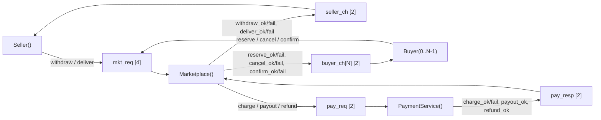
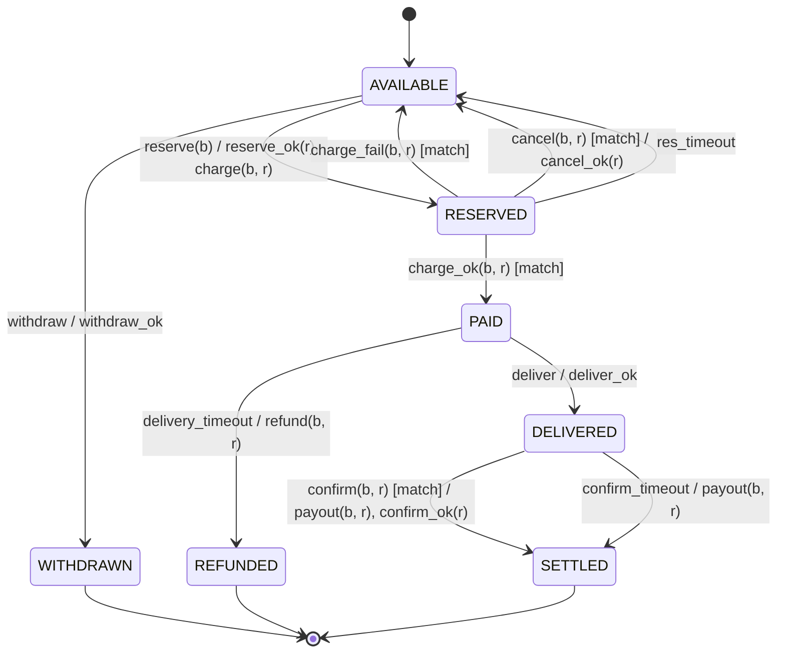

# M1 Report Section — System Architecture & Marketplace State Machine

**Author:** Nguyen Quoc Khang (M1, `10423055`) · **Branch:** `main` (`feat/marketplace` merged via PR #5)  
**Specification:** [Revised Project Proposal](revised_project_proposal.md), Sections 4–7  
**Role Contract:** [Role Execution Plan](temp_role_execution_plan.md), Section 3  
**Models:** [`models/defs.pml`](../models/defs.pml), [`models/02_final.pml`](../models/02_final.pml), [`models/01_naive.pml`](../models/01_naive.pml)

---

## 1. System Architecture & Shared Interface

The Ticket Reservation System is structured as four concurrent PROMELA process types communicating exclusively through five bounded, lossless FIFO channels (Assumption 1), initialized atomically in `init`:

* **`1` `Marketplace()`** — central state machine owning the listing lifecycle (`ticket_state`), reservation assignment `(current_buyer, current_res_id)`, command serialization, timeout modeling, and stale-payment refund routing.
* **`1` `PaymentService()`** — asynchronous payment gateway and integer escrow ledger (`balance[N]`, `escrow`, `seller_bal`, `charge_status[]`, `charge_payer[]`).
* **`1` `Seller()`** — listing owner issuing `withdraw` or `deliver` (or non-delivery).
* **`N` `Buyer(byte id)`** (`id ∈ {0, ..., N - 1}`, base `N = 2`, scaled up to `N = 4`) — competing buyers issuing bounded `reserve` attempts (`K = 2`), racing `cancel`, explicit `confirm`, or silence.

### 1.1 Shared Channel & State Contract (`models/defs.pml`)

| Artifact | Declaration (`models/defs.pml`) | Purpose & Design Rule |
| :--- | :--- | :--- |
| **Parameters** | `N = 2`, `K = 2`, `INIT_BAL = K`, `B0 = N * K`, `NO_BUYER = 255`, `NO_RES = 0`, `MAX_RES_ID = (N * K) + 2` | Overridable via `-DN=` / `-DK=` for scalability benchmarks. `MAX_RES_ID` bounds unique reservation IDs `1..(N * K)` without wraparound. |
| **User Command Queue** | `chan mkt_req = [4] of { mtype:msg, byte, byte }` | Carries `{ msg_type, sender_id, res_id }` from `Seller` and all `N` `Buyer` processes (`NO_RES` for `reserve`/`withdraw`/`deliver`). |
| **Buyer Reply Queues** | `chan buyer_ch[N] = [2] of { mtype:msg, byte }` | Strictly **1-to-1 replies** to explicit user commands (`reserve`, `cancel`, `confirm`) per FR-3. `Marketplace` never pushes unsolicited payment events (`charge_ok`/`charge_fail`) onto `buyer_ch[b]`, preventing reply collisions and buffer overflow. |
| **Seller Reply Queue** | `chan seller_ch = [2] of { mtype:msg }` | Strictly 1-to-1 replies (`withdraw_ok/fail`, `deliver_ok/fail`) to `Seller`. |
| **Payment Channels** | `chan pay_req = [2] of { mtype:msg, byte, byte }` `chan pay_resp = [2] of { mtype:msg, byte, byte }` | Asynchronous bidirectional command/response link (`charge`, `payout`, `refund` $\leftrightarrow$ `charge_ok/fail`, `payout_ok`, `refund_ok`) carrying `(b, r)`. |
| **Core Listing State** | `mtype:state ticket_state = AVAILABLE;` `byte current_buyer = NO_BUYER;` `byte current_res_id = NO_RES;` `byte next_res_id = 1;` `bool deliveryConfirmed = false;` | Owned exclusively by `Marketplace()`. `current_buyer` and `current_res_id` track the active reservation in `RESERVED` and remain permanently latched to the winning buyer once `PAID` is entered (`S1`). |

---

## 2. Listing Lifecycle & State-Transition Matrix

The listing progresses through four active states (`AVAILABLE`, `RESERVED`, `PAID`, `DELIVERED`) and terminates in one of three immutable terminal states (`WITHDRAWN`, `REFUNDED`, `SETTLED`):

*(Note: Stale `charge_ok(b, r)` replies whose `(b, r)` does not match an active `RESERVED` listing are intercepted in every state—including terminal states in `end_mkt:`—and routed to `pay_req ! refund(b, r)` without mutating `ticket_state`.)*

### 2.1 Complete Transition Matrix (`Marketplace()` in `models/02_final.pml`, Lines 22–236)

| Phase / State | Event / Input | Guard Condition | Atomic State & Ghost Updates (`d_step`) | Channel Outputs | Next State | FR / Property |
| :--- | :--- | :--- | :--- | :--- | :--- | :--- |
| **Phase 1:** `AVAILABLE` | `mkt_req ? reserve(b, _)` | `nfull(pay_req) && ticket_state == AVAILABLE && b < N && next_res_id < MAX_RES_ID` | `OBS_RESERVE_GRANT()`; `assigned_r = next_res_id`; `current_res_id = assigned_r`; `next_res_id++`; `current_buyer = b`; `ticket_state = RESERVED` | `buyer_ch[b] ! reserve_ok(assigned_r)`; `pay_req ! charge(b, assigned_r)` | `RESERVED` | FR-4, FR-6, S2 |
| **Phase 1:** `AVAILABLE` | `mkt_req ? withdraw(_, _)` | `nfull(pay_req) && ticket_state == AVAILABLE` | `OBS_WITHDRAW()`; `ticket_state = WITHDRAWN` | `seller_ch ! withdraw_ok` | `WITHDRAWN` | FR-5, S3 |
| **Phase 1:** `RESERVED` | `pay_resp ? charge_ok(b, r)` | `ticket_state == RESERVED && b == current_buyer && r == current_res_id && r != NO_RES` | `OBS_CHARGE_ACCEPT(b, r)`; `ever_paid = true`; `sale_count++`; `sale_buyer = b`; `sale_res_id = r`; `ticket_state = PAID` | *(none)* | `PAID` | FR-7, S1, S4 |
| **Phase 1:** `RESERVED` | `pay_resp ? charge_fail(b, r)` | `ticket_state == RESERVED && b == current_buyer && r == current_res_id && r != NO_RES` | `current_buyer = NO_BUYER`; `current_res_id = NO_RES`; `ticket_state = AVAILABLE` | *(none)* | `AVAILABLE` | FR-8(a), L1 |
| **Phase 1:** `RESERVED` | `mkt_req ? cancel(b, r)` | `nfull(pay_req) && ticket_state == RESERVED && b == current_buyer && r == current_res_id && r != NO_RES && b < N` | `current_buyer = NO_BUYER`; `current_res_id = NO_RES`; `ticket_state = AVAILABLE` | `buyer_ch[b] ! cancel_ok(r)` | `AVAILABLE` | FR-8(b), L1 |
| **Phase 1:** `RESERVED` | Abstract `res_timeout` | `ticket_state == RESERVED` | `current_buyer = NO_BUYER`; `current_res_id = NO_RES`; `ticket_state = AVAILABLE` | *(none)* | `AVAILABLE` | FR-8(c), A6, L1 |
| **Phase 1:** `PAID` | `mkt_req ? deliver(_, _)` | `nfull(pay_req) && ticket_state == PAID` | `ever_delivered = true`; `ticket_state = DELIVERED` | `seller_ch ! deliver_ok` | `DELIVERED` | FR-10(a), S5 |
| **Phase 1:** `PAID` | Abstract `delivery_timeout` | `ticket_state == PAID && nfull(pay_req)` | `delivery_timed_out = true`; `ticket_state = REFUNDED` | `pay_req ! refund(current_buyer, current_res_id)` | `REFUNDED` | FR-10(b), A6, L2, L5 |
| **Phase 1:** `DELIVERED` | `mkt_req ? confirm(b, r)` | `nfull(pay_req) && ticket_state == DELIVERED && b == current_buyer && r == current_res_id && r != NO_RES && b < N` | `deliveryConfirmed = true`; `ticket_state = SETTLED` | `pay_req ! payout(b, r)`; `buyer_ch[b] ! confirm_ok(r)` | `SETTLED` | FR-11(a), S5, L5 |
| **Phase 1:** `DELIVERED` | Abstract `confirm_timeout` | `ticket_state == DELIVERED && nfull(pay_req)` | `deliveryConfirmed = true`; `ticket_state = SETTLED` | `pay_req ! payout(current_buyer, current_res_id)` | `SETTLED` | FR-11(b), A6, S5, L5 |
| **Phase 1 & 2:** *Any* | `pay_resp ? charge_ok(b, r)` *(stale)* | `ticket_state != RESERVED \|\| b != current_buyer \|\| r != current_res_id \|\| r == NO_RES` | `stale_refund_pending++` *(listing state untouched)* | `pay_req ! refund(b, r)` | *(unchanged)* | FR-9, S4, L3, L4 |
| **Phase 1 & 2:** *Any* | `pay_resp ? refund_ok(b, r)` | `r != sale_res_id` *(stale refund ack)* | `if (stale_refund_pending > 0) stale_refund_pending--` | *(none)* | *(unchanged)* | L4 |
| **Phase 1 & 2:** *Any* | `pay_resp ? charge_fail` *(stale)* / `payout_ok` / active `refund_ok` | Non-matching `charge_fail` or settlement ack | *(no state mutation)* | *(none)* | *(unchanged)* | FR-2 |
| **Phase 1 & 2:** *Any* | Unauthorized / wrong-state command on `mkt_req` | Guard fails | *(no state mutation)* | `reserve_fail(NO_RES)` / `cancel_fail(r)` / `confirm_fail(r)` / `withdraw_fail` / `deliver_fail` | *(unchanged)* | FR-3, S2, S3, S5 |

---

## 3. Concurrency Hardening & Verification Design Decisions

### 3.1 Monotonic Reservation IDs `(b, r)` Eliminate the ABA & Double-Sale Races (`S1`, `S4`)

Under FR-6, `Marketplace` immediately dispatches `charge(b, r)` upon granting `reserve_ok(r)`. Because `PaymentService` executes asynchronously, `res_timeout` or `cancel(b, r)` can release the listing back to `AVAILABLE` while `charge(b, r)` is still in flight. If the *same* buyer `b` then wins a second reservation `r2`, a delayed `charge_ok(b, r1)` carries an identical `buyer_id` (`b == current_buyer`).

* In `models/01_naive.pml`, dropping `r == current_res_id` (`[BUG-2]`) allows `charge_ok(1, 1)` to be misapplied to reservation `r = 2`, producing the 43-step ABA counterexample `trails/01_naive_S4.trail`, and combining it with re-entrant `PAID` acceptance (`[BUG-1]`) produces the 53-step double-sale counterexample `trails/01_naive_S1.trail`.
* In `models/02_final.pml`, `Marketplace` enforces the four-part guard `ticket_state == RESERVED && b == current_buyer && r == current_res_id && r != NO_RES`. Any mismatched `charge_ok(b, r)` falls into the stale branch (FR-9), leaves `(ticket_state, current_buyer, current_res_id)` untouched, increments `stale_refund_pending`, and immediately sends `pay_req ! refund(b, r)`.

### 3.2 Two-Level Atomicity (`atomic` + `d_step`) & Pre-State Observers (FR-2, Assumption 3)

Every `Marketplace` handler uses a two-level atomicity discipline:
1. **`d_step { ... }` for pure state + ghost mutations:** All variable updates (plus pre-state observer calls `OBS_RESERVE_GRANT()`, `OBS_WITHDRAW()`, `OBS_CHARGE_ACCEPT(b, r)`) execute in one deterministic indivisible transition. No blocking channel operation ever appears inside `d_step`, and no LTL never-claim can observe a torn intermediate state (e.g., `ticket_state == PAID` before `sale_buyer` or `sale_count` is updated).
2. **`atomic { ... }` around each message/timeout handler:** Formalizes Assumption 3 (*"the marketplace handles one incoming message or timeout event to completion before reading the next"*) and resets dead local variables (`msg = 0; b = 0; r = 0; assigned_r = 0`) before releasing atomicity. As measured in [`m3_ltl_and_counterexamples.md`](m3_ltl_and_counterexamples.md) §7, this preserves every inter-process concurrency race while collapsing redundant mid-handler interleavings and stale-local state duplicates (reducing `N = 2, K = 2` from `> 34M` unfinishable states down to `12,427,383` states).

### 3.3 Preventing Circular Channel-Fill Deadlocks (`nfull(pay_req)` Asymmetry)

Because `Marketplace` writes to `pay_req [2]` and reads from `pay_resp [2]`, while `PaymentService` reads from `pay_req [2]` and writes to `pay_resp [2]`, naive reading from `mkt_req` can cause a circular channel deadlock under FR-6 auto-charge when multiple reservations expire quickly:
* If both `pay_req` and `pay_resp` are full (`2` items each) and `Marketplace` reads a new `reserve` from `mkt_req`, `Marketplace` blocks on `pay_req ! charge(...)` while `PaymentService` is simultaneously blocked on `pay_resp ! charge_ok(...)`.

**Fix in `models/02_final.pml`:**
* All branches that *inject new work* into `pay_req` (`mkt_req`, `delivery_timeout`, and `confirm_timeout`) require **`nfull(pay_req)`** in their guard.
* Conversely, `pay_resp ? msg, b, r` is **never** guarded on `nfull(pay_req)` (in either Phase 1 or Phase 2). Reading a message from `pay_resp` always frees a slot in `pay_resp` first—immediately unblocking `PaymentService`, which finishes its reply and consumes from `pay_req`, freeing a slot for any subsequent stale `pay_req ! refund(b, r)`.

This asymmetric back-pressure keeps `pay_req` and `pay_resp` compact at capacity `[2]` while preventing circular buffer deadlocks for arbitrary `N >= 2` and `K >= 1`.

### 3.4 Two-Phase Termination (`end_active:` & `end_mkt:`) for Escrow Resolution (`S3`, `L3`, `L4`)

`Marketplace()` separates its active lifecycle from terminal draining:
* **Phase 1 (`end_active:`):** Runs while `!is_terminal`. Once `ticket_state` enters `SETTLED`, `WITHDRAWN`, or `REFUNDED`, `:: is_terminal -> break` transitions immediately into Phase 2. The `end_active:` label allows a legitimately unsold `AVAILABLE` listing (all buyers out of `K` attempts, seller idle, all channels empty) to terminate cleanly without falsely triggering an invalid end state—while never masking deadlocks in `RESERVED`, `PAID`, or `DELIVERED` (where abstract timeouts remain enabled) or with non-empty channels.
* **Phase 2 (`end_mkt:`):** Once terminal, `ticket_state` is never mutated again (`S3`), yet `end_mkt:` keeps servicing **both**:
  1. Late `mkt_req` user commands → explicit `*_fail` rejection (FR-3, no blocked participants).
  2. Late `pay_resp` messages → any delayed `charge_ok(b, r)` arriving after `WITHDRAWN`, `REFUNDED`, or `SETTLED` still triggers `pay_req ! refund(b, r)` and decrements `stale_refund_pending` on `refund_ok(b, r)`. Without `pay_resp` draining inside `end_mkt:`, late charges arriving after terminal transitions would remain stuck in `escrow` forever and violate `L3` (`escrow > 0 -> <> escrow == 0`) and `L4` (`stale_refund_pending > 0 -> <> stale_refund_pending == 0`).

### 3.5 Abstract Timeout Modeling & Delivery/Confirmation Races (FR-8, FR-10, FR-11, `S5`)

Rather than relying on SPIN's built-in `timeout` keyword (which fires only when *all* processes are globally blocked and would miss mid-flight timeout races), all three timeouts are modeled as guarded non-deterministic transitions:
* `res_timeout` (`ticket_state == RESERVED`): races freely with `cancel(b, r)` and `charge_ok`/`charge_fail`.
* `delivery_timeout` (`ticket_state == PAID && nfull(pay_req)`): races with `Seller`'s `deliver` (FR-10). Whichever `Marketplace` processes first wins—either moving to `DELIVERED` (`deliver_ok`) or `REFUNDED` (`refund(current_buyer, current_res_id)`), and rejecting any subsequent losing `deliver` with `deliver_fail`.
* `confirm_timeout` (`ticket_state == DELIVERED && nfull(pay_req)`): races with the winning buyer's `confirm(b, r)` (FR-11, Assumption 6). Both branches atomically set `deliveryConfirmed = true` and `ticket_state = SETTLED` **before** dispatching `pay_req ! payout(...)`, guaranteeing `S5` (`seller_bal > 0 -> (ever_delivered && deliveryConfirmed && ticket_state == SETTLED)`) in every reachable state.

---

## 4. Review & Sign-Off of Collaborative Integration (`main` `c8be33d`)

As M1 owner of `models/defs.pml` and `Marketplace()` in `models/02_final.pml`, I reviewed all collaborative changes merged onto `main`:
* **`models/defs.pml` (M3 co-sign, PR #4):** Approved. Adding `charge_payer[MAX_RES_ID]`, `LEDGER_OK`, `payout_res`, `violation_bad_withdraw`, and the pre-state `OBS_*` hooks preserves M1's v2 interface cleanly without affecting protocol guards.
* **`[M3]` annotations inside `Marketplace()` (`models/02_final.pml` L22–L236):** Approved. Wrapping handlers in `atomic { ... }`, clearing dead locals inside those blocks, inserting `OBS_*` calls inside `d_step`, and adding `end_active:` preserve 100% of M1's state-machine logic while making exhaustive `N = 2, K = 2` verification tractable.
* **M2 integration (`Seller`, `Buyer`, and `models/03_two_listings.pml`, PRs #6–#7):** Approved. Participant commands strictly match FR-3 (1-to-1 replies, no `pay` command) and exercise all races (`reserve` vs. `withdraw`, `cancel` vs. `charge`, `deliver` vs. `delivery_timeout`, `confirm` vs. `confirm_timeout`, and spoofed requests).

---

## 5. M1 Acceptance Criteria Sign-Off

Verified against [`temp_role_execution_plan.md`](temp_role_execution_plan.md) §3.3 and M3's exhaustive `02_final.pml` (`N = 2, K = 2`) verification results in [`m3_ltl_and_counterexamples.md`](m3_ltl_and_counterexamples.md) §6.1:

* [x] `models/defs.pml` v2 frozen and aligned across M1, M2, and M3 (`N = 2, 3, 4` parametric `LEDGER_OK` macros verified).
* [x] `Marketplace()` never sends unsolicited messages on `buyer_ch[b]` (strict 1-to-1 replies per FR-3).
* [x] `charge_fail(b, r)` releases `RESERVED -> AVAILABLE`; stale `charge_ok(b, r)` triggers `pay_req ! refund(b, r)` in every state (including `end_mkt:`) without mutating `ticket_state`.
* [x] `DELIVERED` resolves via both explicit `confirm(b, r)` and `confirm_timeout`, satisfying `S5` and `L5`.
* [x] Integrated `models/02_final.pml` passes deadlock freedom (`-DSAFETY -DNOCLAIM`, `12,427,383` states), all 7 safety claims (`S1`–`S7`), and all 5 weak-fairness liveness claims (`L1`–`L5`, `-a -f -DNFAIR=3`) with **`0 errors`** (ready for M4's automated `run_checks.sh` & scalability benchmark pass).
